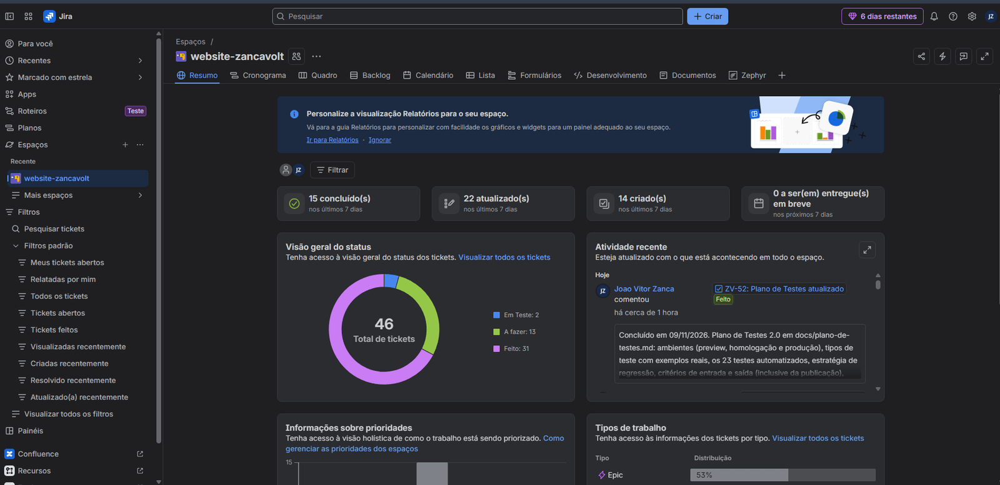
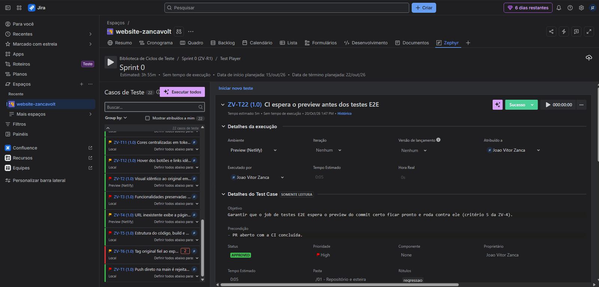
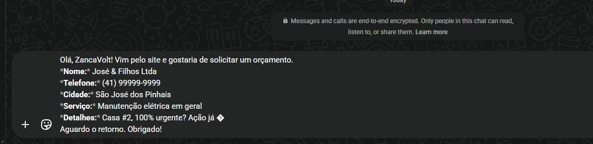
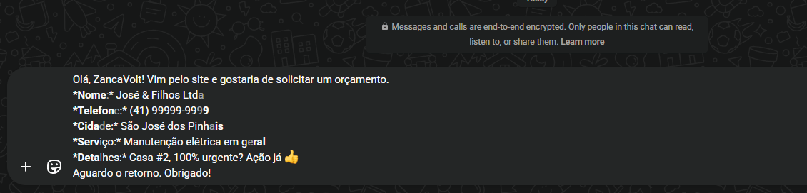
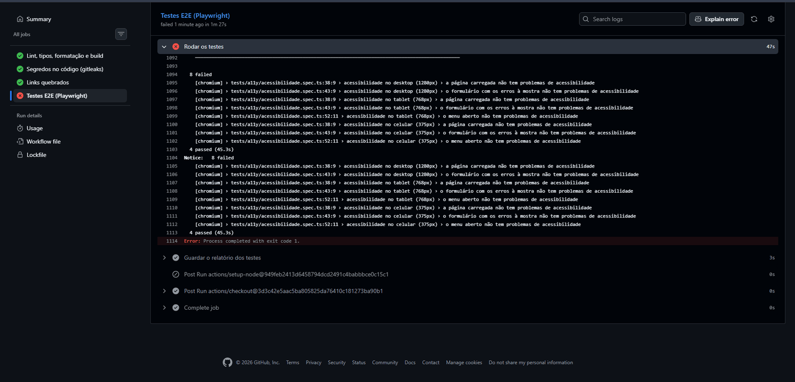
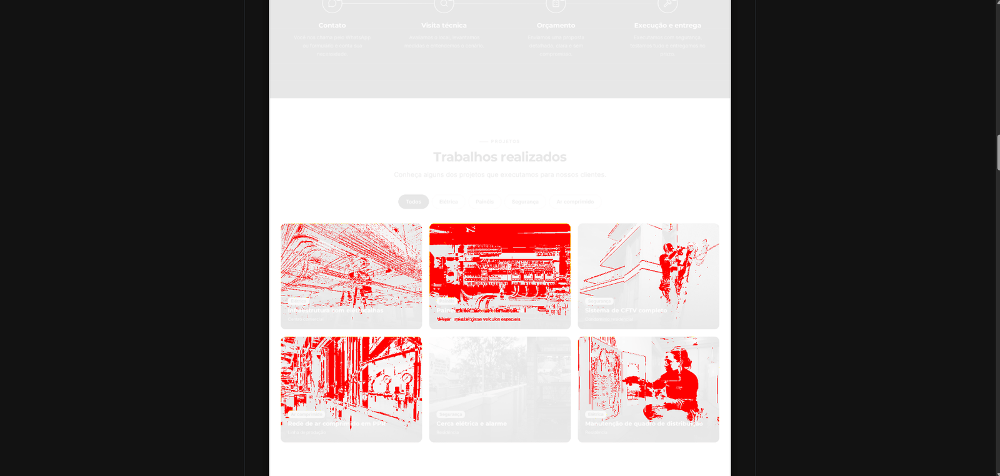

# Estudo de caso — QA no site da ZancaVolt

**Resumo:** conduzi o QA de um site real, do primeiro commit à publicação, em 6 sprints: o site foi para o ar com 23 testes automatizados em todo Pull Request, acessibilidade conferida, nota A+ em segurança e Lighthouse 93 no celular.

| | |
|---|---|
| **Papel** | QA (e PO do site) |
| **Período** | 15/10 a 16/11/2026, 6 sprints de uma semana |
| **Time** | Eu como QA e PO; o desenvolvimento foi feito por IA (Claude), a meu pedido |
| **Ferramentas** | Jira, Zephyr Scale, Playwright, axe, GitHub Actions, SonarCloud, Netlify, Lighthouse |
| **Links** | [Site no ar](https://zancavolt.com.br) · [Repositório](https://github.com/joaozanca/website-zancavolt) · [Plano de Testes](plano-de-testes.md) |

## Contexto e problema

A ZancaVolt presta serviços elétricos, de segurança eletrônica e de ar comprimido em São José dos Pinhais, Curitiba e região. A empresa precisava de um site que **gerasse contatos pelo WhatsApp** e passasse confiança para indústrias, comércios, condomínios e residências.

O desafio de qualidade: um site pequeno, mas que **não pode errar no contato**. Um número errado no botão do WhatsApp ou um formulário que não envia significa cliente perdido, sem ninguém perceber.

## Meu papel

- Defini o escopo das sprints e **aprovei os critérios de aceite** de cada card na Planning.
- Montei e executei os **casos de teste no Zephyr Scale** (96 casos, ZV-T1 a ZV-T96), com um ciclo por sprint e evidências em cada passo. Os rascunhos dos casos foram redigidos com apoio da IA; a definição do que testar, a execução e o julgamento foram meus.
- Testei em **aparelhos reais** (iPhone e dois celulares Samsung) além do navegador.
- Registrei **bugs** no Jira, decidi a prioridade e fiz o reteste.
- **Aprovei ou reprovei** cada entrega antes do merge.
- Defini os **cenários dos testes automatizados**. O código foi escrito pela IA a meu pedido; eu revisei, rodei e vi cada teste falhar antes de aceitar.

## Abordagem e decisões

**Testar antes do merge, num ambiente igual ao real.** Cada Pull Request ganhou um site de teste (preview). Os testes manuais e os automáticos rodam nele, então o que chega à `main` já foi testado.

**Automatizar o que mais dói se quebrar.** Comecei pelos fluxos de contato (E2E), depois acessibilidade (axe em três tamanhos de tela), fumaça no site publicado e, por último, regressão visual. Hoje são **23 testes em todo PR**.

**Todo teste precisa ser visto falhando.** Foi assim que descobri que a regressão visual, com tolerância de 0,1%, **deixava passar** a logo com o Z em azul. A tolerância foi trocada por um limite de 50 pixels.

**Investigar antes de "consertar" um teste.** Quando um teste falhou do nada na CI, ele foi rodado 20 vezes seguidas antes de qualquer mudança: a causa era um erro passageiro da hospedagem, não o site nem o teste.

**Ir além do simulador.** No celular de verdade, o selo da hospedagem cobria o botão do WhatsApp, e o Samsung Internet escurecia o site no modo escuro. Nenhum dos dois aparecia no DevTools.

**Adaptar o processo às limitações reais.** Quando os créditos grátis de publicação acabaram, a publicação passou a ser feita só por release, a partir de uma branch de produção, com homologação e teste de fumaça.

## Resultado

- Site no ar em **[zancavolt.com.br](https://zancavolt.com.br)**, encontrado no Google e com perfil da empresa verificado.
- **23 testes automatizados** em todo PR (4 E2E, 8 de acessibilidade, 3 de fumaça e 8 de regressão visual) e **3 testes de fumaça** contra o site no ar a cada publicação.
- **Lighthouse 93** no celular (era 75) e nota **A+** no securityheaders.com.
- **4 bugs registrados** e tratados, **2 entregas reprovadas** com reteste aprovado, e outros achados corrigidos dentro do próprio card.
- Monitoramento do site a cada 5 minutos, com alerta por e-mail.

## O que eu faria diferente

- Calcularia antes o custo de cada publicação na hospedagem, para não descobrir o limite do plano grátis no meio da sprint.
- Teria definido desde o início que a seção de projetos mostraria mais de uma foto por serviço: como PO, deixei isso para depois, e a galeria virou trabalho para uma próxima versão.

## Evidências

**Gestão no Jira:** visão geral do projeto, com os tickets por status.

**Casos e execuções no Zephyr Scale:** ciclo da Sprint 0. O caso em vermelho falhou e virou o bug ZV-12; a execução fica no histórico.

**Bug encontrado e retestado (ZV-23):** o emoji da mensagem chegava quebrado no WhatsApp. Depois da correção, o reteste passou. Os dados são fictícios.

**Automação achando problema real:** os 8 testes de acessibilidade (axe) falharam na CI e apontaram o botão flutuante fora das regiões da página. A correção entrou no mesmo PR.

**Regressão visual automática:** na troca de fotos do portfólio, o Diff mostrou em vermelho só os 5 cartões alterados. As referências novas só foram aprovadas depois dessa conferência.

